# Secure GPU Stack

A security layer for GPU instances running [Lambda Stack](https://lambda.ai/lambda-stack-deep-learning-software).
Lambda Stack gets researchers a working driver, CUDA and PyTorch. This adds what it leaves out:

- every SSH login needs the key **and** a code from Google Authenticator or Microsoft Authenticator;
- the side doors around SSH are closed;
- the box is patched and locked down, without breaking the GPU or a running training job.

It is one re-runnable installer (`sudo ./install.sh`) with seven modules, plus an audit tool that measures any
instance before and after. Both were run on a real Lambda A10 instance, and every number below comes from that
run.

[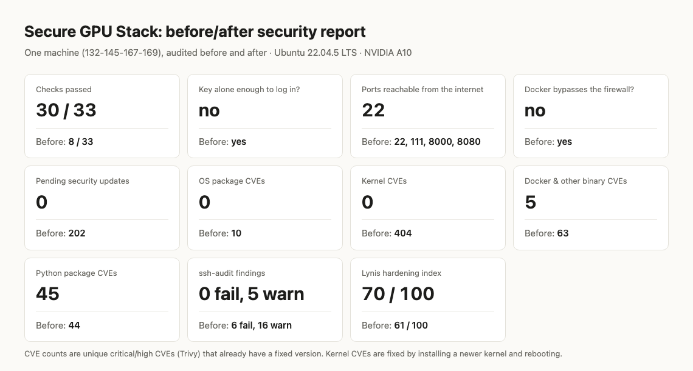](evidence/report.md)

**Full report:** [evidence/report.md](evidence/report.md) (all 37 checks, before and after, with the evidence file
behind each) · [report.html](evidence/report.html) (the same report as a styled page; download it and open it in a
browser)

| On a real `gpu_1x_a10`, Lambda Stack 22.04 | Stock image | With Secure GPU Stack |
|---|---|---|
| Checks passed ([full report](evidence/report.md)) | 8 / 33 | **30 / 33** |
| A stolen SSH key is enough to log in | yes | **no**: key + authenticator code |
| Root shell without SSH, through the browser IDE | yes | **no** |
| Ports reachable from the internet (with services listening on 8000 and 8080) | 22, 111, 8000, 8080 | **22** |
| `docker run -p` bypasses the host firewall | yes | **no** |
| Pending security updates | 202 | **0** |
| Fixable critical/high CVEs: OS / kernel / Docker and other binaries | 10 / 404 / 63 | **0 / 0 / 5** |
| Fixable critical/high CVEs in Python packages (reported, not auto-upgraded; [why](docs/FINDINGS.md#still-open)) | 44 | 45 |
| A malicious checkpoint runs code when loaded | yes | **no** |
| ssh-audit | 6 fail, 16 warn | 0 fail, 5 warn |
| GPU: CUDA, PyTorch, GPU in containers | works | **works** (smoke test 3/3) |

The last column also includes the kernel, driver and CUDA updates the installer holds back so it never breaks
a running job, applied afterwards with a reboot (`sudo SGS_PATCH_ALL=1 ./install.sh --only updates && sudo reboot`).
Right after `install.sh` alone the result is 28/33, with those updates waiting.

### Reviewing this quickly

1. Watch [What it looks like](#what-it-looks-like): recordings of the stock image and the hardened one, each
   with the exact text to look for.
2. Check any claim in the [requirement-to-evidence map](evidence/README.md#requirement--evidence): every claim has
   a raw file or a recording next to it.
3. Read [FINDINGS.md](docs/FINDINGS.md): what the stock image exposes, and what is still open.
4. The core of the challenge is [`modules/10-ssh-mfa.sh`](modules/10-ssh-mfa.sh) and
   [`bin/sgs-enroll`](bin/sgs-enroll).

## What it looks like

Recorded on the Lambda A10: once on the **stock image (before)**, once with **Secure GPU Stack installed
(after)**. "Look for" quotes the exact text that proves each point. The [evidence index](evidence/README.md#recordings)
lists the command behind every recording and keeps a PNG of each final frame.

### 1. Logging in over SSH

**Before**: `ssh` with just the key.

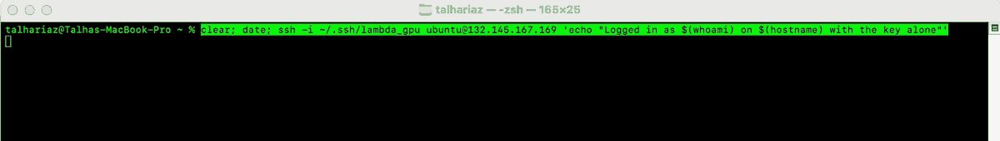

Look for: no code prompt, straight to `Logged in as ubuntu … with the key alone`. Anyone with a copy of the key
is in.

**After**: the same command.

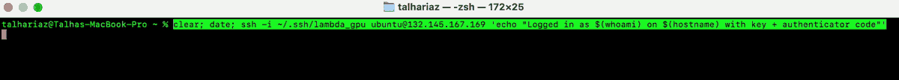

Look for: `Verification code:` after the key is accepted, then `Logged in … with key + authenticator code`. The
code came from Google Authenticator.

### 2. Attacks on SSH (after)

**A stolen key on its own.** `ssh -o BatchMode=yes` can't answer the code prompt, just like a script holding a
stolen key.

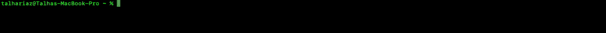

Look for: `Permission denied (keyboard-interactive)`. The key was accepted, but there is no way in without the code.

**Guessing codes.**

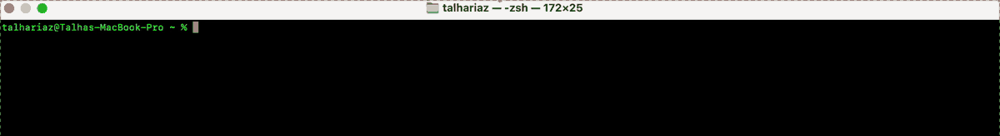

Look for: three `Verification code:` prompts, then `Too many authentication failures`.

**Repeat offenders.**

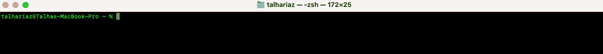

Look for: `Connection refused`. After repeated failures fail2ban blocks the address outright. During the test it
also banned two real attackers ([log](evidence/lambda-a10/fail2ban_ban.txt)).

### 3. The side door around SSH

**Before**: Lambda's console has a "Launch" button that opens JupyterLab in the browser.

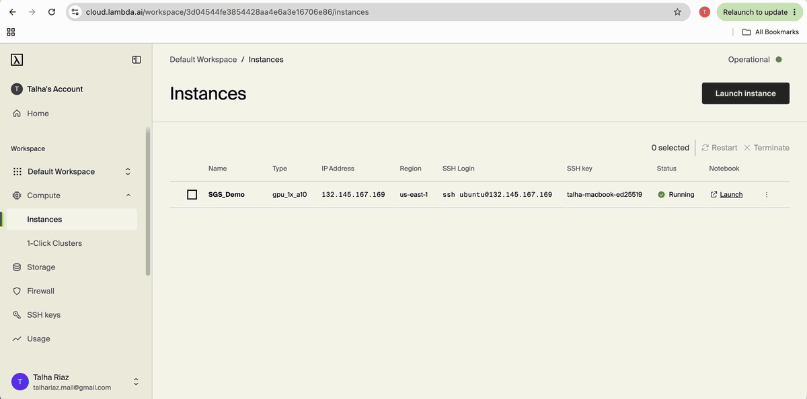

Look for: the `lambdaspaces.com` address (an outbound tunnel no firewall sees), then `whoami` → `ubuntu` and
`ROOT WITHOUT PASSWORD`. That is root on the GPU box with no SSH key and no code.

**After**: the IDE and its tunnel are off.

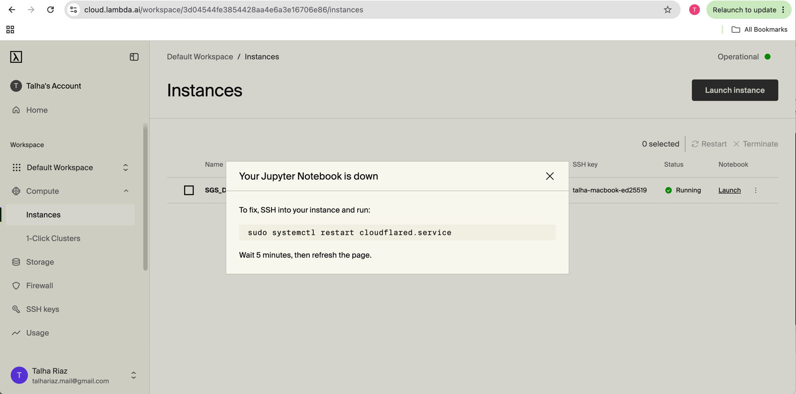

Look for: Lambda's own console saying `Your Jupyter Notebook is down`. Section 7 shows the safe way to use Jupyter.

### 4. Ports exposed to the internet

Run from the tester's laptop. Two stand-in services were listening the whole time: a web server on 8000 and a Docker
container on 8080, plus the image's own rpcbind on 111.

**Before**

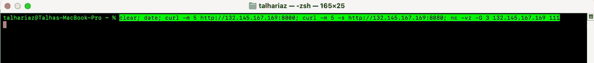

Look for: `if you can read this from outside, it is exposed` twice, and `port 111 … succeeded!`.

**After**: the same services, still running.

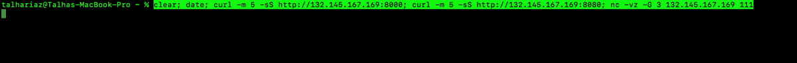

Look for: `Connection timed out` twice and `port 111 … failed: Operation timed out`. The host firewall now drops
them, including the Docker container, which normally bypasses it.

### 5. A malicious model checkpoint

[`tests/gpu_smoke.py`](tests/gpu_smoke.py) checks CUDA, then plants a booby-trapped checkpoint that runs code
when loaded.

**Before**

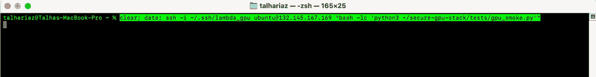

Look for: `1/3 passed`: `scanner not installed` and `payload ran: True`.

**After**

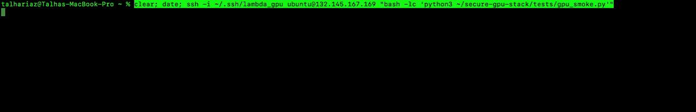

Look for: `3/3 passed`. The scanner reports `dangerous import`, and `torch.load` is `refused (UnpicklingError),
payload did not run`. The `UserWarning` underneath is PyTorch commenting on the file's pickle format, not a
failure.

### 6. The GPU still works (after)

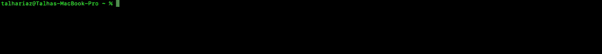

Look for: `Verification code:` (it's still SSH with MFA), then `NVIDIA A10, 580.105.08` on the host and
`GPU 0: NVIDIA A10` inside a Docker container.

### 7. Jupyter, the safe way (after)

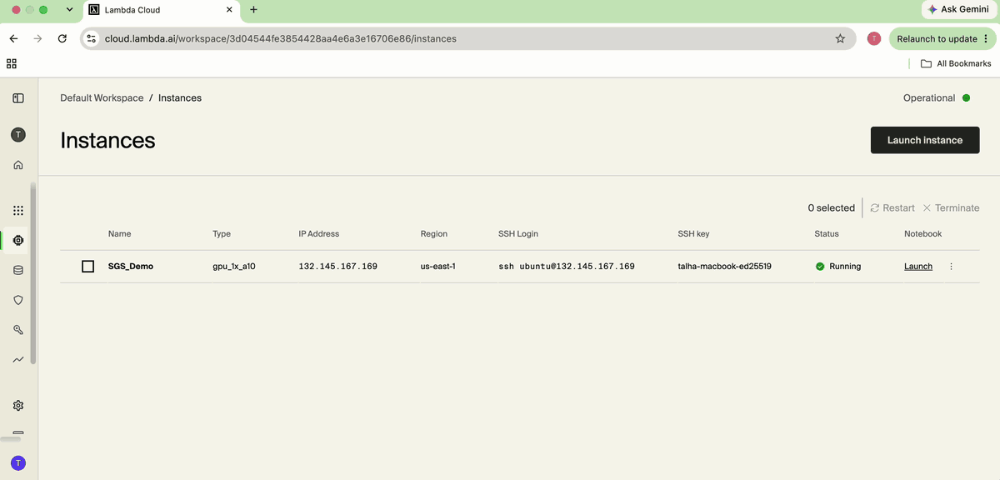

Look for: `ssh -L 8888:127.0.0.1:8888 …` asking for `Verification code:`, then JupyterLab at `127.0.0.1:8888` in the
browser. It is reached through the SSH tunnel, behind the key and the code. The recording is cut where it would show
the instance's login banner (the tester's IP) and Jupyter's access token.

### Enrolling

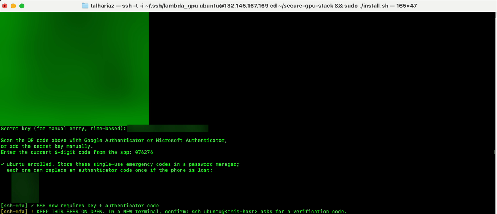

Look for: the QR code for Google or Microsoft Authenticator; the code typed back to confirm it; `ubuntu enrolled`;
then `SSH now requires key + authenticator code`. The secret only takes effect after a valid code, so a bad scan
can't lock anyone out. The QR code, secret and emergency codes are blurred.

## The challenge, point by point

| Ask | What was built | Proof |
|---|---|---|
| "for each ssh to require a microsoft or google authenticator app approval to get in" | Every new SSH connection needs the key, then a 6-digit code (TOTP, the standard both apps implement). Without both, nobody gets in. There are no passwords and no root login, and accounts that haven't set up a code are refused. | [key alone, before](evidence/media/ssh-before-key-alone-logs-in.gif) · [key + code](evidence/media/ssh-after-key-and-code.gif) · [key alone, refused](evidence/media/ssh-after-key-alone-denied.gif) · [wrong code, refused](evidence/media/ssh-after-wrong-code-denied.gif) · [`sshd_T.txt`](evidence/lambda-a10/after/sshd_T.txt) · [`ssh_server_log.txt`](evidence/lambda-a10/extra/ssh_server_log.txt) |
| "improve the starting stack that loads with the gpu in ways it can be more secure" | Seven modules on top of Lambda Stack: [SSH](modules/10-ssh-mfa.sh), [firewall](modules/20-firewall.sh), [kernel](modules/30-kernel.sh), [audit trail](modules/40-audit-logging.sh), [updates](modules/50-updates.sh), [GPU and IDE](modules/60-gpu.sh), [ML supply chain](modules/70-supply-chain.sh) | [report](evidence/report.md): 8 → 30 of 33 checks; [GPU smoke test](evidence/lambda-a10/after/gpu_smoke.txt) 3/3 |
| "compare the images" | The stock Lambda Stack image and the hardened one, audited by the same tool on the same instance: stock, then after install, a kernel update and a reboot | [`evidence/lambda-a10/`](evidence/lambda-a10/) ([before](evidence/lambda-a10/before/) · [after](evidence/lambda-a10/after/)) |
| "the cheapest gpu" | `gpu_1x_a10` | [instance](evidence/media/lambda-instance-running.png) |

**"Approval" is a code, not a push notification.** Both apps can approve a login in two ways:
- **A 6-digit code (TOTP).** It's an open standard and works offline: the server checks the code itself.
- **A push notification you tap.** That requires a cloud identity service (Microsoft Entra ID, Duo, Okta) to send
  the push, an account with it, and its availability at every login.

For a standalone GPU instance, the code keeps the second factor on the box with no third party in the login
path. The recordings use Google Authenticator. Microsoft Authenticator implements the same TOTP standard
(RFC 6238) and adds the same QR code, but it wasn't used in this run. For a team that already runs one of those services, push means swapping the PAM module (for example Duo's
`pam_duo`); the sshd side stays the same.

## What each module does

| Module | Changes |
|---|---|
| [`10-ssh-mfa`](modules/10-ssh-mfa.sh) | `AuthenticationMethods publickey,keyboard-interactive` with `pam_google_authenticator`. **Secrets:** stored root-only, outside users' homes; no `nullok`; single-use codes; 3 tries per 30 s; emergency codes. **SSH settings:** no passwords, no root; `MaxAuthTries 3`, `MaxSessions 1`, `PerSourceMaxStartups 3`; no X11 or agent forwarding; `LogLevel VERBOSE`; ssh-audit's crypto profile with post-quantum key exchange first; DH moduli of 3072 bits or more. **Safety:** checked with `sshd -t` and rolled back on error; the installer flags accounts that would skip the code or can't log in. |
| [`20-firewall`](modules/20-firewall.sh) | **ufw** denies inbound except SSH. **Docker's bypass is closed:** `DOCKER-USER` drops new outside connections to containers, and Docker publishes on `127.0.0.1` by default; it is never restarted under running containers. **fail2ban** bans brute force, including wrong codes, and escalates repeat offenders. |
| [`30-kernel`](modules/30-kernel.sh) | 30 sysctl settings (the audit checks 21 of them): kernel pointers, eBPF, kexec, link and FIFO protections, setuid core dumps, redirects, spoofed packets. Applied in boot order and checked, so they survive a reboot. IP forwarding (Docker needs it) and `ptrace_scope 1` (py-spy needs it) are left alone. |
| [`40-audit-logging`](modules/40-audit-logging.sh) | auditd records changes to SSH, PAM, sudoers, accounts, firewall, Docker, apt and cron, any read of the MFA secrets, `~/.ssh` changes, and every root command with the person who logged in. Rules are reloaded after boot so none are lost. |
| [`50-updates`](modules/50-updates.sh) | Security updates now and daily: Ubuntu, Docker, the NVIDIA Container Toolkit and cloudflared. **Kernel, driver and CUDA are held** for a planned window, since a driver swap under a running job breaks it. **It never reboots or restarts services on its own;** it reports what needs one. The toolkit is pinned so Lambda's older build can't replace it. |
| [`60-gpu`](modules/60-gpu.sh) | Stops and masks the browser IDE and its outbound tunnel, and makes the tunnel credentials root-only. Pins GPU performance counters to admins. Makes sure the NVIDIA Container Toolkit is past its container-escape fixes (≥ 1.17.8). |
| [`70-supply-chain`](modules/70-supply-chain.sh) | `torch.load` accepts only tensors and plain data in every login shell (`TORCH_FORCE_WEIGHTS_ONLY_LOAD=1`). Adds `sgs-scan-model` (picklescan, pinned and checksum-verified) to check checkpoints before loading. Flags apt sources that skip signature checks. |

What it deliberately does **not** do:
- auto-reboot;
- auto-upgrade the driver, CUDA or ML libraries;
- remove Lambda's repositories;
- change GPU device permissions (containers need them).

[Design decisions](#design-decisions) explains each.

## Install

**You need:**
- a Lambda instance (Lambda Stack, Ubuntu 22.04) launched with your SSH key;
- Google Authenticator or Microsoft Authenticator on your phone;
- `ssh` and Python 3 on your laptop (only for the measurements; no packages needed).

The commands below assume your SSH key is loaded in ssh-agent or is your default key; otherwise add
`-i <path to your key>` to `ssh` and `scp`. **Want before/after numbers?** Run the first half of
[Measure it yourself](#measure-it-yourself) before step 2.

**1. Copy the repository to the instance** (from your laptop):

```bash
scp -r secure-gpu-stack ubuntu@<ip>:          # or, on the instance: git clone <repository URL> secure-gpu-stack
```

**2. Install** (on the instance, as `ubuntu`):

```bash
ssh ubuntu@<ip>
cd secure-gpu-stack
sudo ./install.sh --dry-run    # optional: show every change, apply nothing
sudo ./install.sh              # scan the QR code with your app and type the code it shows
```

The install takes 5–10 minutes. Most of it is installing the pending security updates (about 200 on a fresh
image), which prints nothing until it finishes. If it seems stuck after `[updates] installing pending security
updates`, it isn't: give it up to 10 minutes.

**3. Check** before you close that session. Lambda has no recovery console, so a lockout would mean losing the
instance. Keep the session open and, in a **new** terminal:

```bash
ssh ubuntu@<ip>                # now asks "Verification code:" after the key
```

Store the emergency codes the installer printed. Running `sudo ./install.sh` again changes nothing
([proof](evidence/lambda-a10/after/install_rerun.log)). `./install.sh --list` shows the modules; `--only` and
`--skip` select them.

| Setting | Effect |
|---|---|
| `SGS_ALLOW_PORTS="443/tcp"` | Open more inbound ports |
| `SGS_FAIL2BAN_IGNOREIP="203.0.113.5"` | Never ban these addresses |
| `SGS_BROWSER_IDE=keep` | Leave Lambda's browser IDE running (its terminal bypasses SSH MFA) |
| `SGS_SSH_MAX_SESSIONS=4` | Allow more sessions per connection (default 1) |
| `SGS_PATCH_ALL=1` | Also upgrade the held kernel, driver and CUDA (reboot afterwards) |
| `SGS_AUDIT_IMMUTABLE=1` | Lock the audit rules until reboot |

Pass them through sudo, for example `sudo SGS_ALLOW_PORTS=443/tcp ./install.sh`.
Removing a port from `SGS_ALLOW_PORTS` and running again closes it.

## Measure it yourself

**From the evidence in this repository** (no instance needed):

```bash
python3 audit/report.py evidence/lambda-a10/before evidence/lambda-a10/after -o report   # writes report.md and report.html
```

**On your own instance**, before and after installing. The audit runs on the instance, the external scan from
your laptop, and the report wherever both results are:

```bash
# on the instance, BEFORE ./install.sh
cd secure-gpu-stack
sudo ./audit/demo_services.sh start                     # optional: two deliberately exposed services for the firewall to block
sudo ./audit/run_audit.sh before --out ~/sgs-before     # a few minutes; --no-trivy skips the CVE scan

# on your laptop
scp -r ubuntu@<ip>:sgs-before .
python3 secure-gpu-stack/audit/external_scan.py <ip> --out sgs-before/external.json

# on the instance: install (step 2 above), then
sudo ./audit/run_audit.sh after --out ~/sgs-after

# on your laptop (copying now asks for the code)
scp -r ubuntu@<ip>:sgs-after .
python3 secure-gpu-stack/audit/external_scan.py <ip> --out sgs-after/external.json
python3 secure-gpu-stack/audit/report.py sgs-before sgs-after -o report
```

Expect about 28/33 right after install: the kernel, driver and CUDA updates the installer holds back are still
waiting (see the note under the results above).

Lambda's default cloud firewall only lets port 22 through, so the external scan looks the same before and after.
To measure the host firewall, as the evidence does, add a cloud firewall ruleset that allows all TCP from your IP
only.

**What the audit does:**
- It only collects; it changes no security setting.
- It installs pinned, checksum-verified scanners (Trivy, ssh-audit) plus Lynis.
- [`report.py`](audit/report.py) judges 37 checks (33 scored, 4 informational) from the raw files, and names the
  files each check read.

**No GPU needed:** a local Ubuntu 22.04 VM through [Lima](https://lima-vm.io) (`brew install lima` on macOS)
shows everything except the GPU parts.

```bash
tests/lima/create_vm.sh sgs-test                      # prints the VM's IP and an ssh command with a test key
limactl copy -r . sgs-test:/tmp/secure-gpu-stack
limactl shell sgs-test                                # then, inside the VM:
  sudo cp -r /tmp/secure-gpu-stack /opt/ && cd /opt/secure-gpu-stack && sudo ./install.sh --user ubuntu
ssh -i tests/lima/.keys/test_key -o IdentitiesOnly=yes ubuntu@<vm-ip>   # from your laptop: asks for the code
```

Lima manages the VM through your own account, so the test VM exempts that one account from MFA. The installer and
the audit both flag it, which also shows the exempt-account check working. Once `ubuntu` is enrolled on
`sgs-test`, and a second VM `sgs-stock` exists as the untouched baseline,
[`tests/lima/iterate.sh`](tests/lima/iterate.sh) runs a full install → audit → report round in one command.

## Day to day

**Adding a person** (as `ubuntu`, in `~/secure-gpu-stack`). They can't log in until they're enrolled:

```bash
sudo adduser --disabled-password --gecos "" alice     # no password: alice logs in with her key and her code
sudo install -d -m 700 -o alice -g alice /home/alice/.ssh
echo "<alice's public key>" | sudo tee /home/alice/.ssh/authorized_keys
sudo chown alice:alice /home/alice/.ssh/authorized_keys
sudo sgs-enroll alice                                 # alice scans the QR shown here (in person or on a call)
sudo ./install.sh --only audit-logging                # adds the audit watch on alice's ~/.ssh
```

Lost phone: `sudo sgs-enroll alice --force` issues a new secret, or she uses one of her emergency codes.

**Jupyter or TensorBoard** listen on localhost and are reached through SSH, so they sit behind the key and the
code. Lambda installs JupyterLab for the `ubuntu` account only; any other account runs
`python3 -m pip install --user jupyterlab` once, then logs in again.

```bash
jupyter lab --no-browser --ip 127.0.0.1 --port 8888   # on the instance, as ubuntu
ssh -L 8888:localhost:8888 ubuntu@<ip>                # on your laptop
```

Then open the `http://127.0.0.1:8888/lab?token=…` link Jupyter printed (`jupyter server list` shows it again).

**Checking a model** before anyone loads it:

```bash
sgs-scan-model ./downloaded-model.bin
```

## Design decisions

- **A layer, not a fork of the image.** Lambda Stack's value is its curated driver, CUDA and PyTorch set. This
  changes configuration around it and leaves those packages alone, so it applies to any instance Lambda launches,
  today's image or next month's.
- **Code-based MFA, enforced by sshd itself.** It needs no external service at login. Secrets sit in a root-only
  directory, not `~/.google_authenticator`, so a process running as the user can't copy them and clone the second
  factor. No `nullok`, so forgetting to enroll fails closed.
- **Holds, not auto-reboots.** Unattended kernel or driver upgrades are the classic way to kill a week-long
  training run. Everything else patches daily; the kernel, driver and CUDA move together in a window the team
  picks. The report counts what is waiting, so the hold is visible, not silent.
- **Close the browser IDE by default.** It is a root terminal that SSH MFA can't cover, published through a tunnel
  no firewall sees. Jupyter itself is kept, behind `ssh -L`. Teams that accept the Lambda console login as their
  gate can opt back in.
- **Firewall Docker too.** "ufw deny" with a public `docker run -p` is the most common false sense of security on
  GPU boxes. Both layers are covered: the `DOCKER-USER` chain and the localhost publish default.
- **Never weaken research workflows quietly.** IP forwarding stays on (Docker), `ptrace_scope` stays 1 (py-spy,
  gdb), GPU devices stay world-usable (containers), and Python packages are reported, not upgraded under
  experiments.
- **Measure, don't assert.** The audit is separate from the installer, collects raw output only, and the report
  says which file every verdict came from, so any reviewer can check a number without trusting the tool.

## Limitations

The full list is in [THREAT_MODEL.md](docs/THREAT_MODEL.md) and [FINDINGS.md](docs/FINDINGS.md#still-open).

- **Applied after boot, not baked into an image.** Until `install.sh` runs, the stock exposure applies, narrowed
  by Lambda's default cloud rule (SSH only). A custom image or launch-time automation would close that window.
- **Audit logs stay on the host**, so root can erase them. Shipping them off the box is the real fix.
- **The weights-only default reaches login shells only** (every interactive SSH session). Commands run as
  `ssh host 'cmd'`, systemd units and containers don't get it.
- **An authenticated connection kept open by the user's own client** can open new sessions one after another
  without a new code; `MaxSessions 1` only stops them running in parallel.
- **Tested on Ubuntu 22.04**, on Lambda (x86_64, A10) and in local VMs (arm64). Ubuntu 24.04 is untested.
- **3 checks still don't pass:** classical SSH key exchanges kept for older clients, 5 CVEs waiting on vendor
  rebuilds, and Python CVEs inside Lambda's (now disabled) IDE environment and Microsoft's Azure CLI.

## How it was tested

**On local VMs** (Lima, Ubuntu 22.04): many install → audit → fix rounds; a fresh install of the final code; a
second run that rewrote 0 files; a real reboot that kept every setting.

**On a real Lambda `gpu_1x_a10`** (1x A10, us-east-1, Lambda Stack 22.04; full
[test setup](evidence/README.md#test-setup) and [evidence](evidence/README.md)):
1. Audit of the stock image.
2. Install, then the recordings above.
3. The held kernel, driver and CUDA updates installed, real reboot, previous kernel removed.
4. The final code re-applied (a second run that rewrote 0 files), then a second real reboot.
5. Final audit, with the GPU smoke test and the GPU inside a container.

All shell code passes `shellcheck`.

## Repository layout

```
install.sh                 entry point: runs modules/ in order, --dry-run, --only/--skip, --list
lib/common.sh              shared helpers: idempotent writes with backups, dry-run diffs, logging
modules/                   the seven hardening modules
bin/sgs-enroll             MFA enrollment (QR in the terminal, confirmed by a code before it takes effect)
audit/                     run_audit.sh (collect), external_scan.py (outside view), report.py (judge), demo_services.sh
tests/                     gpu_smoke.py (CUDA + malicious checkpoint), Lima VM harness
evidence/                  raw evidence, report and recordings from the Lambda A10 run
docs/                      FINDINGS.md, THREAT_MODEL.md
```
